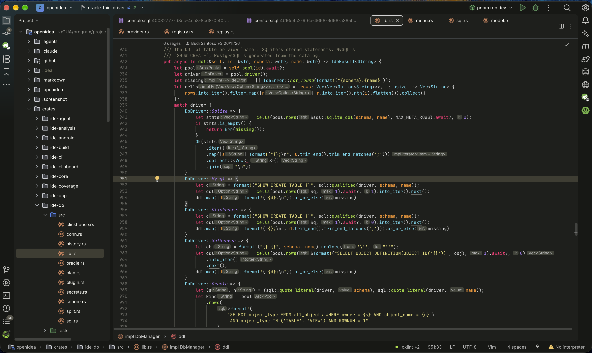
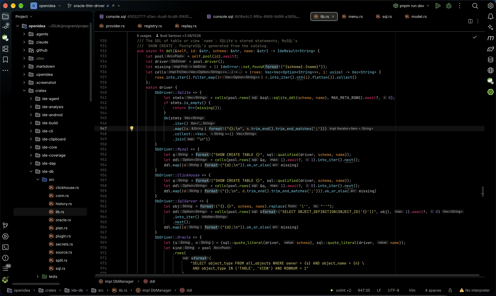
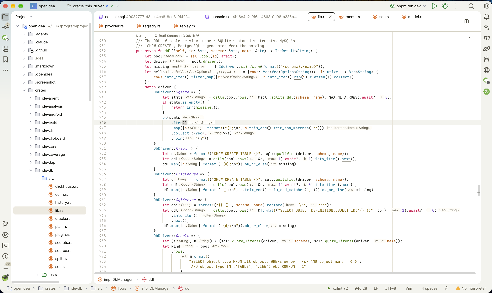

# Monokai Flat Fancy Theme for OpenIDEA

[Monokai Flat Fancy](https://github.com/boenkkk/monokai-flat-fancy) for
[OpenIDEA](https://github.com/l0ng-ai/openidea) — Monokai's syntax on a flatter, more
minimal workbench — in the three variants the VS Code extension ships:

| Default | Darker | Light |
| --- | --- | --- |
|  |  |  |

| Variant | Kind | Editor background | Accent |
| --- | --- | --- | --- |
| Monokai Flat Fancy Default | dark | `#1e1f1c` | `#819aff` |
| Monokai Flat Fancy Darker | dark | `#000000` | `#819aff` |
| Monokai Flat Fancy Light | light | `#ffffff` | `#0f649c` |

- Each variant is a UI theme plus an editor colour scheme, and sets all 252 themeable
  tokens: surfaces, text, accent, VCS and diff colours, syntax, editor, and the
  ANSI/terminal palettes.
- The workbench keeps the theme's flat, warm-neutral surfaces; selections, tabs and
  toolbars stay in that family rather than taking the accent.
- Syntax follows the extension's TextMate colours: pink keywords, yellow strings,
  cyan types, green functions and attributes, purple numbers and constants, orange
  parameters, `#88846f` comments.

## Install

Settings › Plugins › ⚙ › **Install Plugin from Disk…**, pick this folder, then select
the plugin and press **Apply** next to the variant you want.

## Capabilities

None. This is a data-only plugin: six JSON files (`*.theme.json`, `*.scheme.json`). It
runs no code and asks for no network, process or file system access.

## Notes

- **Accent.** The extension fills badges and buttons with `#0f649c`. On the dark
  backgrounds that is only 2.6:1 as text, so Default and Darker use the extension's own
  bright blue (`terminal.ansiBrightBlue`, `#819aff`) where OpenIDEA paints text and
  focus rings in `--accent`; Light keeps `#0f649c` (6.3:1 on white).
- **Kept as designed upstream.** Monokai's `#f92672` keywords reach 4.4:1 on the dark
  editor and the `#88846f` comments the same, just under WCAG AA. They are the theme's
  signature colours, so they are unchanged. Decorative tokens (faint text, line numbers)
  are below AA by design, as in the other OpenIDEA themes.
- **Light ANSI.** The extension uses one dark-terminal ANSI set for all three variants.
  Light therefore darkens the slots (and repeats the normal colours as bright ones) so
  terminal text stays readable on white.

## Building

The theme files are generated from the Monokai Flat Fancy palette (`palette.json`, plus
the greys its workbench is built from).

```sh
python3 generate.py
openidea-plugin check .
openidea-plugin pack . --key <publisher>.key --publisher boenkkk
```

For a local build, drop `--key`/`--publisher`: `pack . --out dist/` writes an unsigned
package the IDE still installs (it shows the unsigned warning), and `openidea-plugin
link .` loads this folder live while iterating. `generate.py` and `palette.json` are not
part of the package.

## Contributing

If you found a problem, or have a feature request, please open an [issue](https://github.com/boenkkk/openidea-monokai-flat-fancy-theme/issues) about it.

## License

MIT © Budi Santoso

## For more information

* [Boenkkk Blog](https://blog.boenkkk.dev)
